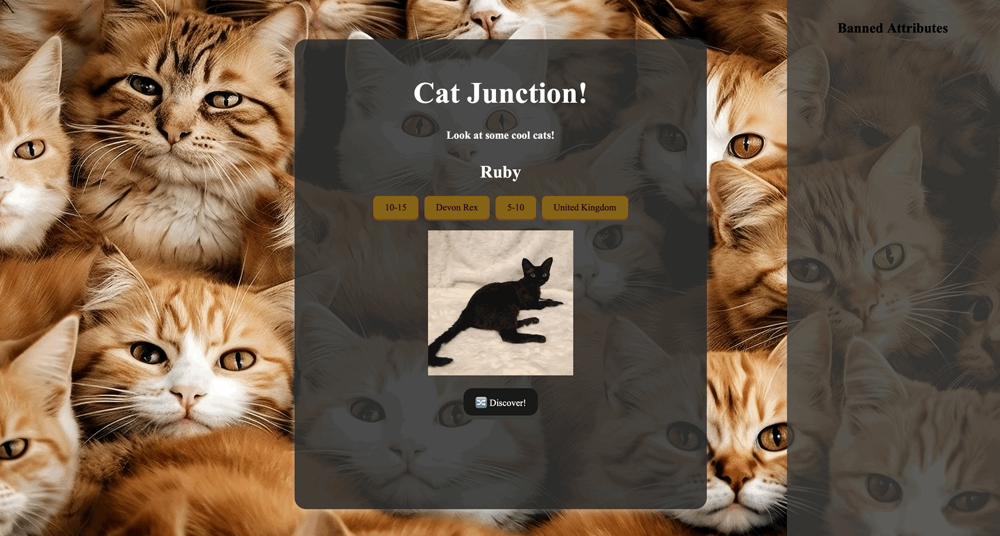

# WEB 102 - PROJECT 4

Cat Junction is an interactive web application built using React and Vite that allows users to discover different cat breeds and learn about their characteristics.

This project was developed as part of CodePath's WEB102 Intermediate Web Development course.

## Project Demo



## Features

- **Random Cat Discovery:** Generate random cats using The Cat API.
- **Breed Information:** Display information about each cat, including breed, origin, lifespan, and weight.
- **Ban List:** Exclude specific attributes from future discoveries.
- **Dynamic Filtering:** Filter results based on the user's selected restrictions.
- **Interactive UI:** Update content dynamically without refreshing the page.

## Technologies Used

- React.js
- JavaScript (ES6+)
- Vite
- CSS3
- The Cat API

## Getting Started

### Prerequisites

Ensure that Node.js and npm are installed.

### Installation

1. Clone the repository:

   ```bash
   git clone https://github.com/SamM-SWE/WEB102-PROJECT4.git
   ```

2. Navigate into the project directory:

   ```bash
   cd WEB102-PROJECT4
   ```

3. Install dependencies:

   ```bash
   npm install
   ```

4. Start the development server:

   ```bash
   npm run dev
   ```

5. Open the local URL displayed in your terminal.

## How It Works

1. Click the Discover button to generate a random cat.
2. View the cat's image and breed characteristics.
3. Click an attribute to add it to the ban list.
4. Generate additional cats while excluding banned attributes.
5. Remove attributes from the ban list whenever desired.

## API Integration

The application integrates with [The Cat API](https://thecatapi.com/) to retrieve cat images and breed information.

API requests are handled asynchronously using JavaScript's `fetch()` method.

## What I Learned

- Integrating third-party REST APIs into React applications.
- Managing component state using React hooks.
- Handling asynchronous API requests.
- Filtering and manipulating JSON data.
- Building interactive user interfaces with React.

## Author

**Samuel Monneh**
